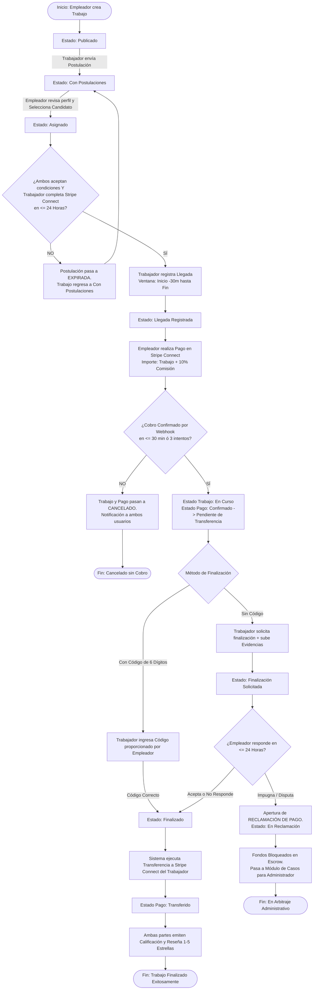
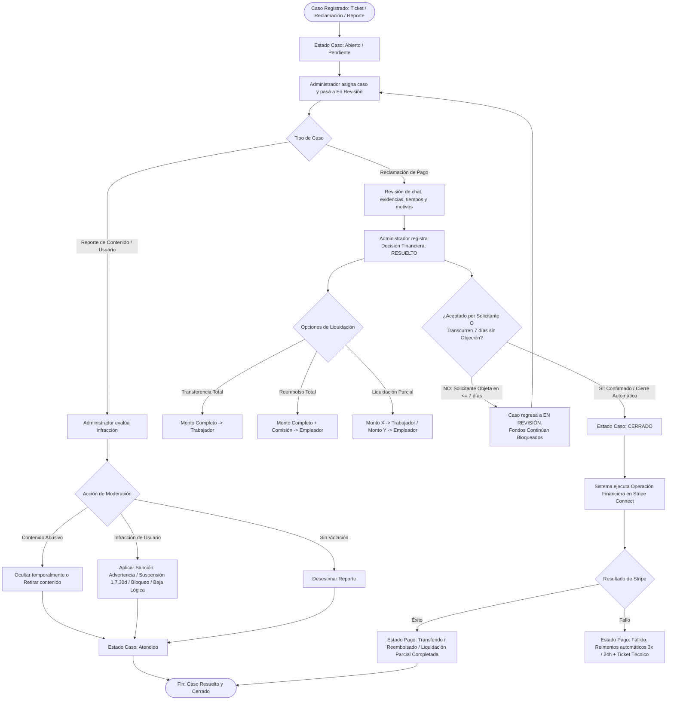
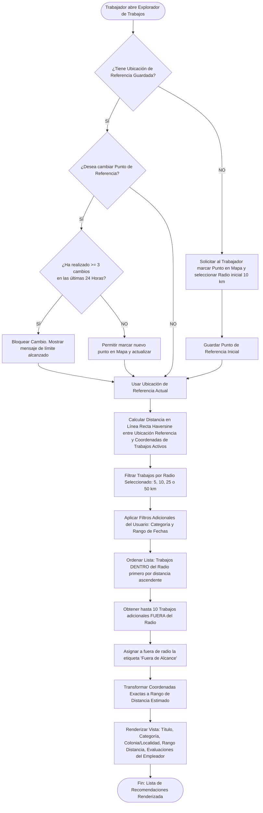
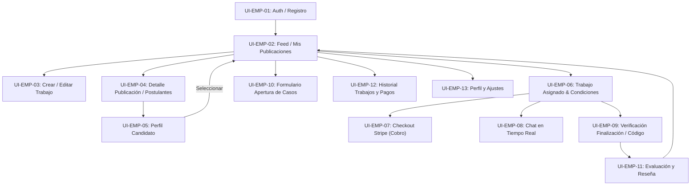
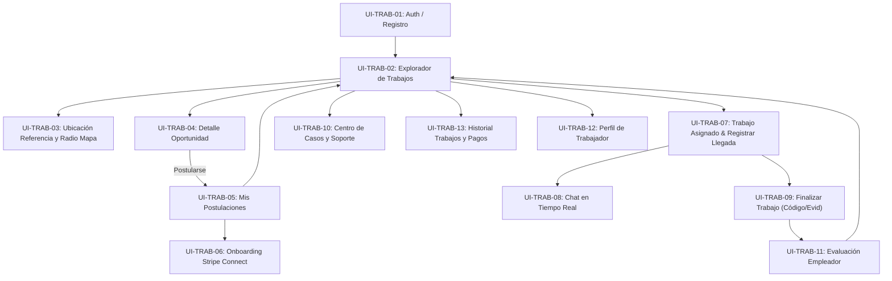
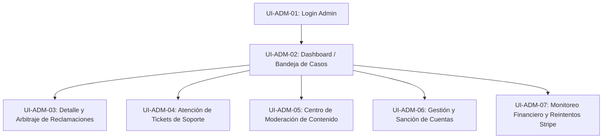

# Diagramas del Sistema

Documentación visual y técnica del sistema:
- [Diagramas de Flujo y Navegación (Hitos 2 y 4)](./diagramas.md)
- [Modelo Entidad-Relación de Base de Datos (Hito 5)](./modelo_erd.md)

---

## 2. Hito 2: Diagramas de Flujo en Markdown / Mermaid

### 2.1 Diagrama del Ciclo de Vida del Trabajo y Procesamiento de Pago (Flujo Principal)



### 2.2 Diagrama del Módulo de Casos, Arbitraje de Pagos y Sanciones (Administrador)



### 2.3 Diagrama del Algoritmo de Búsqueda y Ubicación por Radio del Trabajador



---

## 4. Hito 4: Definición del Flujo de Navegación entre Interfaces (UI Flow)

### 4.1 Diagrama de Navegación — App Móvil Empleador



```text
[UI-EMP-01: Auth / Registro]
       │
       ├──> [UI-EMP-02: Feed / Mis Publicaciones] <─────────────────────────────┐
       │         │                                                              │
       │         ├──> [UI-EMP-03: Crear / Editar Trabajo]                       │
       │         │                                                              │
       │         ├──> [UI-EMP-04: Detalle Publicación / Postulantes]            │
       │         │         │                                                    │
       │         │         └──> [UI-EMP-05: Perfil Candidato] ──(Seleccionar)───┤
       │         │                                                              │
       │         ├──> [UI-EMP-06: Trabajo Asignado & Condiciones]               │
       │         │         │                                                    │
       │         │         ├──> [UI-EMP-07: Checkout Stripe (Cobro)]            │
       │         │         │                                                    │
       │         │         ├──> [UI-EMP-08: Chat en Tiempo Real]                │
       │         │         │                                                    │
       │         │         └──> [UI-EMP-09: Verificación Finalización/Código]  │
       │         │                   │                                          │
       │         │                   └──> [UI-EMP-11: Evaluación y Reseña] ─────┤
       │         │                                                              │
       │         ├──> [UI-EMP-10: Formulario Apertura de Casos]                 │
       │         │                                                              │
       │         ├──> [UI-EMP-12: Historial Trabajos y Pagos]                   │
       │         │                                                              │
       │         └──> [UI-EMP-13: Perfil y Ajustes]                             │
```

---

### 4.2 Diagrama de Navegación — App Móvil Trabajador



```text
[UI-TRAB-01: Auth / Registro]
       │
       ├──> [UI-TRAB-02: Explorador de Trabajos] <──────────────────────────────┐
       │         │                                                              │
       │         ├──> [UI-TRAB-03: Ubicación Referencia y Radio Mapa]           │
       │         │                                                              │
       │         ├──> [UI-TRAB-04: Detalle Oportunidad] ──(Postularse)──┐        │
       │         │                                                      │        │
       │         ├──> [UI-TRAB-05: Mis Postulaciones] <─────────────────┘        │
       │         │         │                                                     │
       │         │         └──> [UI-TRAB-06: Onboarding Stripe Connect]          │
       │         │                                                              │
       │         ├──> [UI-TRAB-07: Trabajo Asignado & Registrar Llegada]         │
       │         │         │                                                     │
       │         │         ├──> [UI-TRAB-08: Chat en Tiempo Real]                 │
       │         │         │                                                     │
       │         │         └──> [UI-TRAB-09: Finalizar Trabajo (Código/Evid)]   │
       │         │                   │                                           │
       │         │                   └──> [UI-TRAB-11: Evaluación Empleador] ────┤
       │         │                                                               │
       │         ├──> [UI-TRAB-10: Centro de Casos y Soporte]                    │
       │         │                                                               │
       │         ├──> [UI-TRAB-13: Historial Trabajos y Pagos]                    │
       │         │                                                               │
       │         └──> [UI-TRAB-12: Perfil de Trabajador]                        │
```

---

### 4.3 Diagrama de Navegación — Panel Web Administrador



```text
[UI-ADM-01: Login Admin]
       │
       └──> [UI-ADM-02: Dashboard / Bandeja de Casos]
                 │
                 ├──> [UI-ADM-03: Detalle y Arbitraje de Reclamaciones]
                 │
                 ├──> [UI-ADM-04: Atención de Tickets de Soporte]
                 │
                 ├──> [UI-ADM-05: Centro de Moderación de Contenido]
                 │
                 ├──> [UI-ADM-06: Gestión y Sanción de Cuentas]
                 │
                 └──> [UI-ADM-07: Monitoreo Financiero y Reintentos Stripe]
```
