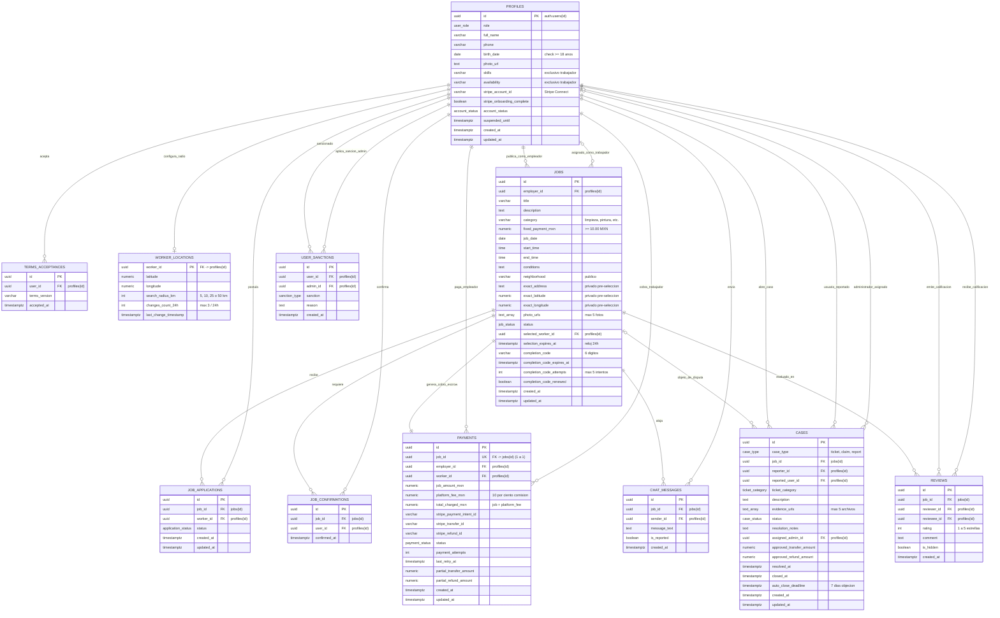

# Modelo Entidad-Relación (ERD) — Base de Datos PostgreSQL / Supabase

Este documento contiene la especificación visual y estructural de la base de datos relacional para el **Sistema de Trabajos Temporales**, construida sobre **PostgreSQL / Supabase**. Incluye el diagrama Entidad-Relación (ERD) en formato Mermaid compatible con GitHub, el catálogo de tipos enumerados, restricciones de integridad y directivas de seguridad (RLS).

---

## 1. Diagrama Entidad-Relación (Mermaid ERD)



---

## 2. Tipos Enumerados (Custom ENUMs)

| Tipo ENUM | Valores Permitidos | Propósito y Módulo |
| :--- | :--- | :--- |
| `user_role` | `'employer'`, `'worker'`, `'admin'` | Define el rol principal asignado al usuario en el sistema. |
| `account_status` | `'active'`, `'warned'`, `'suspended'`, `'blocked'`, `'soft_deleted'` | Control de estado operativo y disciplinario de la cuenta de usuario. |
| `job_status` | `'published'`, `'has_applications'`, `'assigned'`, `'arrival_registered'`, `'in_progress'`, `'completion_requested'`, `'in_claim'`, `'completed'`, `'cancelled'`, `'expired'` | Máquina de estados principal del ciclo de vida de un empleo temporal. |
| `application_status` | `'pending'`, `'accepted'`, `'rejected'`, `'withdrawn'`, `'expired'` | Estados de la postulación enviada por el trabajador a una vacante. |
| `payment_status` | `'not_started'`, `'payment_pending'`, `'confirmed'`, `'failed'`, `'in_claim'`, `'transfer_pending'`, `'transfer_failed'`, `'transferred'`, `'partial_settlement_pending'`, `'partial_settlement_failed'`, `'partial_settlement_completed'`, `'refunded'`, `'cancelled'` | Estados de procesamiento del pago en custodia (Escrow) en Stripe Connect. |
| `case_type` | `'ticket'`, `'claim'`, `'report'` | Categorización del incidente en el módulo unificado de atención administrativa. |
| `case_status` | `'open'`, `'pending'`, `'in_review'`, `'resolved'`, `'closed'`, `'dismissed'`, `'attended'` | Flujo de resolución administrativa de disputas, soporte y moderación. |
| `ticket_category` | `'account'`, `'publication'`, `'application'`, `'job'`, `'payment'`, `'technical'` | Clasificación temática para tickets de asistencia al usuario. |
| `sanction_type` | `'warning'`, `'suspension_1d'`, `'suspension_7d'`, `'suspension_30d'`, `'permanent_block'`, `'soft_delete'` | Niveles de medidas disciplinarias aplicables por los administradores. |

---

## 3. Catálogo de Entidades y Restricciones de Integridad

### 3.1 `profiles`
* **PK:** `id UUID` (vinculada directamente a `auth.users(id)` con `ON DELETE CASCADE`).
* **Check Constraints:** 
  * `check_minimum_age`: `date_part('year', age(birth_date)) >= 18` (Garantiza mayoría de edad).
* **Campos Especializados:**
  * Trabajadores: `skills`, `availability`, `stripe_account_id`, `stripe_onboarding_complete`.
  * Disciplinarios: `account_status`, `suspended_until`.

### 3.2 `terms_acceptances`
* **PK:** `id UUID DEFAULT uuid_generate_v4()`.
* **FK:** `user_id -> profiles(id) ON DELETE CASCADE`.
* **Propósito:** Registro inmutable de auditoría legal de aceptación de Términos y Condiciones y Política de Privacidad con versión y fecha UTC.

### 3.3 `worker_locations`
* **PK/FK:** `worker_id -> profiles(id) ON DELETE CASCADE`.
* **Check Constraints:**
  * `check_valid_radius`: `search_radius_km IN (5, 10, 25, 50)`.
* **Lógica de Trigger:**
  * Controla que un trabajador no realice más de 3 actualizaciones de coordenadas en una ventana móvil de 24 horas mediante `trigger_worker_location_limit`.

### 3.4 `jobs`
* **PK:** `id UUID DEFAULT uuid_generate_v4()`.
* **FKs:** 
  * `employer_id -> profiles(id) ON DELETE CASCADE`
  * `selected_worker_id -> profiles(id) ON DELETE SET NULL`
* **Check Constraints:**
  * `check_min_payment`: `fixed_payment_mxn >= 10.00`
  * `check_max_photos`: Máximo 5 imágenes en el arreglo `photo_urls`.
* **Mecanismo de Finalización:**
  * `completion_code` (6 dígitos), `completion_code_expires_at`, `completion_code_attempts` (máx. 5 intentos), `completion_code_renewed`.

### 3.5 `job_applications`
* **PK:** `id UUID DEFAULT uuid_generate_v4()`.
* **FKs:** `job_id -> jobs(id) ON DELETE CASCADE`, `worker_id -> profiles(id) ON DELETE CASCADE`.
* **Unique Constraint:** `unique_worker_job_application UNIQUE(job_id, worker_id)` (Impide postulaciones duplicadas del mismo trabajador al mismo empleo).

### 3.6 `job_confirmations`
* **PK:** `id UUID DEFAULT uuid_generate_v4()`.
* **FKs:** `job_id -> jobs(id) ON DELETE CASCADE`, `user_id -> profiles(id) ON DELETE CASCADE`.
* **Unique Constraint:** `unique_job_user_confirmation UNIQUE(job_id, user_id)` (Asegura que cada participante confirme una sola vez las condiciones del trabajo).

### 3.7 `payments`
* **PK:** `id UUID DEFAULT uuid_generate_v4()`.
* **FKs:** 
  * `job_id -> jobs(id) ON DELETE CASCADE` con restricción `UNIQUE` (Relación estrictamente 1:1 con `jobs`).
  * `employer_id -> profiles(id)`
  * `worker_id -> profiles(id)`
* **Reglas Financieras:**
  * `platform_fee_mxn`: 10% del importe del trabajo redondeado a centavos.
  * `total_charged_mxn`: Suma exacta de `job_amount_mxn + platform_fee_mxn`.
  * Arbitraje administrativo con campos de resolución parcial: `partial_transfer_amount` y `partial_refund_amount`.

### 3.8 `chat_messages`
* **PK:** `id UUID DEFAULT uuid_generate_v4()`.
* **FKs:** `job_id -> jobs(id) ON DELETE CASCADE`, `sender_id -> profiles(id)`.
* **Propósito:** Mensajería en tiempo real vinculada a un trabajo asignado, con soporte de bandera `is_reported` para moderación.

### 3.9 `cases`
* **PK:** `id UUID DEFAULT uuid_generate_v4()`.
* **FKs:** 
  * `job_id -> jobs(id) ON DELETE SET NULL`
  * `reporter_id -> profiles(id)`
  * `reported_user_id -> profiles(id)`
  * `assigned_admin_id -> profiles(id)`
* **Check Constraints:** Máximo 5 evidencias adjuntas en `evidence_urls`.
* **Control de Plazos:** `auto_close_deadline` (plazo de 7 días naturales para objeción del solicitante antes del cierre y dispersión automática de fondos).

### 3.10 `reviews`
* **PK:** `id UUID DEFAULT uuid_generate_v4()`.
* **FKs:** `job_id -> jobs(id) ON DELETE CASCADE`, `reviewer_id -> profiles(id)`, `reviewee_id -> profiles(id)`.
* **Check Constraints:** `rating BETWEEN 1 AND 5`.
* **Unique Constraint:** `unique_job_reviewer UNIQUE(job_id, reviewer_id)` (Máximo una evaluación por participante por trabajo).

### 3.11 `user_sanctions`
* **PK:** `id UUID DEFAULT uuid_generate_v4()`.
* **FKs:** `user_id -> profiles(id) ON DELETE CASCADE`, `admin_id -> profiles(id)`.
* **Propósito:** Bitácora inmutable de sanciones administrativas aplicadas (advertencias, suspensiones temporales de 1/7/30 días, bloqueo permanente y baja lógica).

---

## 4. Triggers de Lógica de Negocio

### Restricción de Frecuencia de Cambio de Ubicación (`RF-08`)

```sql
CREATE OR REPLACE FUNCTION check_worker_location_limits()
RETURNS TRIGGER AS $$
BEGIN
    IF (OLD.last_change_timestamp < NOW() - INTERVAL '24 hours') THEN
        NEW.changes_count_24h := 1;
        NEW.last_change_timestamp := NOW();
    ELSE
        IF OLD.changes_count_24h >= 3 THEN
            RAISE EXCEPTION 'Se ha alcanzado el límite máximo de 3 cambios de ubicación en un período de 24 horas.';
        END IF;
        NEW.changes_count_24h := OLD.changes_count_24h + 1;
        NEW.last_change_timestamp := NOW();
    END IF;
    RETURN NEW;
END;
$$ LANGUAGE plpgsql;

CREATE TRIGGER trigger_worker_location_limit
BEFORE UPDATE ON public.worker_locations
FOR EACH ROW
WHEN (OLD.latitude IS DISTINCT FROM NEW.latitude OR OLD.longitude IS DISTINCT FROM NEW.longitude)
EXECUTE FUNCTION check_worker_location_limits();
```

---

## 5. Privacidad y Seguridad (RLS & Vistas)

### 5.1 Ocultamiento de Ubicación Exacta (`jobs_public_view`)
Por requerimientos de seguridad y privacidad (`RNF-06`, `S5`, `S7`), las coordenadas exactas (`exact_latitude`, `exact_longitude`) y la dirección completa (`exact_address`) solo se revelan al trabajador seleccionado formalmente:

```sql
CREATE OR REPLACE VIEW public.jobs_public_view AS
SELECT 
    j.id,
    j.employer_id,
    j.title,
    j.description,
    j.category,
    j.fixed_payment_mxn,
    j.job_date,
    j.start_time,
    j.end_time,
    j.conditions,
    j.neighborhood,
    j.photo_urls,
    j.status,
    j.created_at,
    CASE 
        WHEN j.selected_worker_id = auth.uid() THEN j.exact_address 
        ELSE NULL 
    END AS exact_address,
    CASE 
        WHEN j.selected_worker_id = auth.uid() THEN j.exact_latitude 
        ELSE NULL 
    END AS exact_latitude,
    CASE 
        WHEN j.selected_worker_id = auth.uid() THEN j.exact_longitude 
        ELSE NULL 
    END AS exact_longitude
FROM public.jobs j;
```

### 5.2 Directivas Row Level Security (RLS)
* **`profiles`:** Lectura permitida a usuarios autenticados; edición restringida exclusivamente a `auth.uid() = id`.
* **`jobs`:** Empleador posee control total sobre sus publicaciones (`auth.uid() = employer_id`); trabajadores autenticados pueden consultar publicaciones en el explorador.
* **`chat_messages`:** Acceso restringido exclusivamente a los dos participantes del trabajo activo (`employer_id = auth.uid()` o `selected_worker_id = auth.uid()`).
